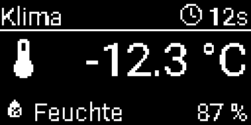
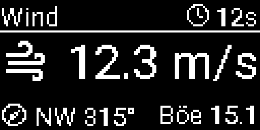
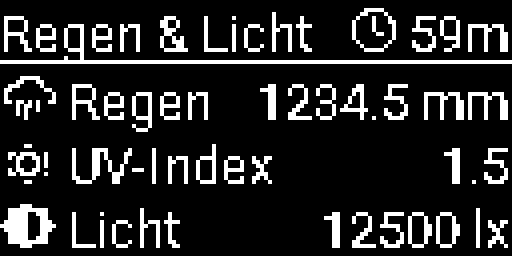
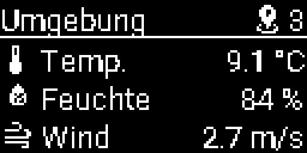
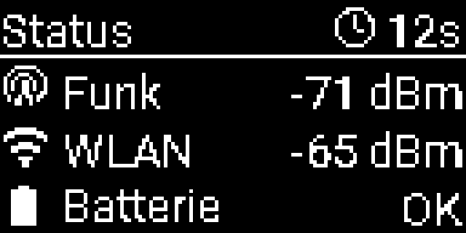

# Bresser-Wettersensoren mit ESPHome

Diese externe ESPHome-Komponente empfängt Bresser-Wettersensoren auf
868,3 MHz und stellt deren Messwerte über die native ESPHome-API in Home
Assistant bereit. Sie läuft wahlweise nativ mit ESP-IDF oder mit Arduino.

Unterstützte Funkchips:

- CC1101
- SX1276
- SX1262
- LR1121

Der integrierte Decoder unterstützt die Bresser-Wetterprotokolle der
3-in-1-, 5-in-1-, 6-in-1-, 7-in-1- und 8-in-1-Familien. In Home Assistant
werden Temperatur, Luftfeuchtigkeit, Wind, Windrichtung, Regen, UV,
Beleuchtungsstärke, Batteriestatus, Sensor-ID und RSSI bereitgestellt, sofern
der jeweilige Außensensor diese Werte sendet.

## Einbindung aus GitHub

```yaml
esp32:
  variant: esp32
  framework:
    type: esp-idf

external_components:
  - source: github://charlyschulte/bresser-esphome@v1.2.0
    components: [bresser_weather]
    refresh: never

bresser_weather:
  radio_type: sx1276
  pins:
    sck: 5
    miso: 19
    mosi: 27
    cs: 18
    reset: 14
    irq: 26
    gpio: 33
  log_sensor_id: true

  temperature:
    name: Außentemperatur
  humidity:
    name: Luftfeuchtigkeit
```

`framework.type` darf `esp-idf` oder `arduino` sein. Für einen Bluetooth-Proxy
kann die ESP-IDF-Konfiguration zum Beispiel so ergänzt werden:

```yaml
esp32_ble_tracker:

bluetooth_proxy:
  active: true
```

Die vollständige Konfiguration für ein LILYGO TTGO LoRa32 V1.x/V1.2 mit
SX1276 befindet sich in [`bresser-el-nino.yaml`](bresser-el-nino.yaml).

## Sensor-ID ermitteln und filtern

`filter_sensor_id` ist optional. Solange kein Filter gesetzt ist, verarbeitet
die Komponente jeden passenden Wettersensor. Mit `log_sensor_id: true` steht
die ID jedes gültigen Telegramms im ESPHome-Log:

```text
Empfangene Sensor-ID: 00003717
```

Anschließend kann genau dieser Sensor ausgewählt werden:

```yaml
bresser_weather:
  filter_sensor_id: 0x00003717
  log_sensor_id: false
```

Die diagnostische Home-Assistant-Entität `sensor_id` kann unabhängig davon
aktiviert bleiben.

## Eigene Station und Umgebung

Empfängt das Board mehrere Stationen, trennt `preferred_sensor_id` die eigene
Station von allen anderen. Die normalen Sensoren zeigen dann nur noch die eigene
Station, `neighbors` den Mittelwert aller übrigen:

```yaml
bresser_weather:
  preferred_sensor_id: 0x00003717
  max_sensors: 8
  stations:
    name: Empfangene Stationen
  temperature:
    name: Außentemperatur
  neighbors:
    timeout: 15min
    temperature:
      name: Umgebung Temperatur
    wind_direction:
      name: Umgebung Windrichtung
    rain:
      name: Umgebung Regenmenge
    station_count:
      name: Umgebung Stationen
```

`neighbors` kennt dieselben Messwerte wie die normalen Sensoren außer `rssi`,
`battery_low` und `sensor_id`. Eine Station ohne Paket innerhalb von `timeout`
fällt aus dem Mittelwert. `stations` listet alle aktiven Stationen mit RSSI; so
lässt sich die eigene ID finden. `max_sensors` begrenzt die Anzahl dieser
Stationen, bei Überlauf weicht die Station mit dem ältesten Paket.

Die Windrichtung wird als Kreismittel berechnet. Die Regenmenge der Umgebung ist
kein Mittel der Zählerstände, sondern summiert den mittleren Zuwachs seit dem
Start des Geräts. `preferred_sensor_id` und `filter_sensor_id` schließen sich aus.

## Beispiel: LILYGO LoRa32 mit OLED

[`examples/lilygo-lora32-oled.yaml`](examples/lilygo-lora32-oled.yaml) zeigt die
eigene Station und den Mittelwert der Umgebung auf dem 0,96-Zoll-Display. Vor dem
ersten Start `preferred_sensor_id` durch die eigene ID ersetzen. Die Seiten wechseln
alle 5 Sekunden. Icons stammen aus Material Design Icons. Die Kopfzeile zeigt das Alter des letzten eigenen Pakets, auf der
Umgebungsseite die Anzahl der gemittelten Stationen. Fehlende Werte erscheinen als `--`.

| Klima | Wind | Regen und Licht |
| --- | --- | --- |
|  |  |  |

| Umgebung | Status |
| --- | --- |
|  |  |

Die Bilder sind mit Beispielwerten gerendert, keine Fotos. Neu erzeugen:
`python docs/render_oled_pages.py Roboto-Regular.ttf materialdesignicons-webfont.ttf docs/oled`

## Radio und Pins

Die Pinbezeichnungen `irq` und `gpio` folgen den beiden Signalleitungen, die
RadioLib für den gewählten Funkchip erwartet:

| `radio_type` | `irq` | `gpio` | `reset` |
| --- | --- | --- | --- |
| `cc1101` | GDO0 | GDO2 | optional |
| `sx1276` | DIO0 | DIO1 | üblich |
| `sx1262` | DIO1 | BUSY | üblich |
| `lr1121` | DIO9/IRQ | BUSY | üblich |

Für ältere Konfigurationen bleibt `dio1` als Alias für `gpio` erhalten. Die
SPI-Pins und alle Radio-Signale stehen bewusst in der YAML, damit beliebige
ESP32-Boards und externe Funkmodule verwendet werden können.

Weitere Optionen unter `bresser_weather`:

| Option | Standard | Bedeutung |
| --- | --- | --- |
| `radio_type` | `sx1276` | Verwendeter Funkchip |
| `max_sensors` | `4` | Anzahl gleichzeitig verwalteter Stationen, 1 bis 32 |
| `frequency_offset` | `0.0` | Korrektur zur Basisfrequenz 868,3 MHz |
| `spi_host` | `spi2` | ESP-IDF SPI-Host; `spi3` nur auf geeigneten ESP32-Varianten |
| `spi_clock` | `2000000` | SPI-Takt in Hz |
| `tcxo_voltage` | – | TCXO-Spannung für SX1262/LR1121 |
| `dio2_as_rf_switch` | `false` | SX1262 DIO2 als internen RF-Schalter verwenden |
| `filter_sensor_id` | – | Optionaler Filter als 32-Bit-ID |
| `preferred_sensor_id` | – | ID der eigenen Station, siehe oben |
| `log_sensor_id` | `true` | Empfangene IDs protokollieren |

Die korrekten Pins sowie TCXO- und RF-Schalter-Einstellungen müssen dem
Schaltplan des verwendeten Boards oder Funkmoduls entnommen werden. Vor dem
Empfang muss eine passende 868-MHz-Antenne angeschlossen sein.

## Lokales Bauen und Installieren

`secrets.yaml.example` als `secrets.yaml` kopieren und eigene Werte eintragen:

```bash
python3 -m venv .venv
.venv/bin/pip install "esphome==2026.8.0"
.venv/bin/esphome run bresser-el-nino.yaml --device /dev/cu.usbserial-XXXX
```

Für das ESPHome-Add-on wird `bresser-el-nino.yaml` nach `/config/esphome/`
kopiert und der lokale `external_components`-Block durch den oben gezeigten
GitHub-Block ersetzt.

## Kompatibilität und Lizenzen

Die Build-Matrix prüft ESP-IDF und Arduino sowie alle vier Funkchips mit
ESPHome 2026.8.0. Eingebunden sind
[BresserWeatherSensorReceiver 0.41.1](https://github.com/matthias-bs/BresserWeatherSensorReceiver)
und [RadioLib 7.7.1](https://github.com/jgromes/RadioLib). Beide Abhängigkeiten
sind für reproduzierbare Builds festgeschrieben. Der native ESP-IDF-HAL basiert
auf dem MIT-lizenzierten RadioLib-ESP-HAL; die Lizenzhinweise befinden sich in
den jeweiligen Quelldateien.
